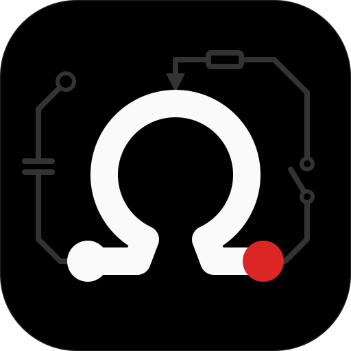

<p align="center">
  
</p>

# ohmtools design

> **Hinweis:** Dieses Projekt wurde größtenteils mit KI generiert: Code,
> Konfiguration und Dokumentation sind mit
> [Claude Code](https://claude.com/claude-code) entstanden.

Ein Erscheinungsbild für alle Apps, Webseiten und Dokumente von ohmtools, seit
dem Redesign von [zeiteisen](https://github.com/ohmtools/zeiteisen) (der
Referenzumsetzung): shadcn/ui `base-vega` mit eigenem Theme, Geist und Geist
Mono, OLED-Schwarz und Weiß als Grund, ein neutrales `primary`, Rot
(`accent-red`) als einzige Akzentfarbe, Daten nach Art gefärbt, Rundungen von
6, 8 und 10px, keine Boxen, drei Stufen von Telefon bis Desktop, eine
Bewegungskurve, hell und dunkel nach Einstellung des Geräts. Die Regeln stehen
in [DESIGN.md](DESIGN.md), die Werte in [`tokens/`](tokens/)
(Design-Token-Format, Farben als sRGB-Hex, die Diagrammfarben in OKLCH); alles
andere wird daraus erzeugt.

| Pfad | Inhalt |
| --- | --- |
| [`DESIGN.md`](DESIGN.md) | Die Regeln und alle Farben als Tabelle |
| [`tokens/`](tokens/) | Quelle aller Werte ([DTCG](https://www.designtokens.org)-JSON) |
| [`shadcn/components.json`](shadcn/components.json) | shadcn-Konfiguration |
| [`shadcn/index.css`](shadcn/index.css) | `src/index.css` einer shadcn-App (erzeugt) |
| [`dist/tokens.css`](dist/tokens.css) | CSS-Variablen für Seiten ohne shadcn (erzeugt) |
| [`dist/tokens.json`](dist/tokens.json) | Alle Farben je Modus als CSS-Wert und Hex, dazu Schriften, Abstände und Bewegung, für alles andere (erzeugt) |
| [`dist/ohmtools-colors.sty`](dist/ohmtools-colors.sty) | Die Farben für LaTeX (erzeugt) |
| [`assets/app-icon.svg`](assets/app-icon.svg) | Vorlage für App-Icons |
| [`assets/logo/`](assets/logo/) | Das Logo der Organisation: Icon, Favicon, Zeichen und Wortmarke für hellen und dunklen Grund, Avatar und Vorschaubild (1280 × 640) als PNG |
| [`examples/index.html`](examples/index.html) | Das Erscheinungsbild nur mit `dist/tokens.css` nachgebaut |

## Verwendung

### shadcn-App (React, Tailwind v4)

1. Das Projekt nach shadcns [Vite-Anleitung](https://ui.shadcn.com/docs/installation/vite)
   aufsetzen, dann `components.json` und `src/index.css` durch
   [`shadcn/components.json`](shadcn/components.json) und
   [`shadcn/index.css`](shadcn/index.css) ersetzen und
   `@fontsource-variable/geist` sowie `@fontsource-variable/geist-mono`
   installieren. App-eigenes CSS kommt ans Ende von `src/index.css`.
2. Komponenten mit `npx shadcn@latest add <name>` hinzufügen, `uppercase`
   sowie `tracking-wider` / `tracking-widest` aus den erzeugten Dateien
   entfernen und die Handanpassungen aus DESIGN.md, „Components“, einbauen
   (roter Lösch-Knopf, Dialog als Blatt von unten auf dem Telefon, gleitender
   Tab-Indikator, …).

   Ist die shadcn-Registry nicht erreichbar (in abgeschotteten Umgebungen
   wie Claude Code im Web antwortet sie mit HTTP 403), die Komponente aus
   zeiteisen (`src/components/ui/`) kopieren, dort sind die Handanpassungen
   schon drin. Fehlt sie auch dort, aus dem Repository
   [shadcn-ui/ui](https://github.com/shadcn-ui/ui) nachbauen, wie es die
   Registry tut: `apps/v4/registry/bases/base/ui/<name>.tsx` nehmen, jede
   Klasse `cn-…` durch ihre `@apply`-Liste aus
   `apps/v4/registry/styles/style-vega.css` ersetzen und `IconPlaceholder`
   durch das genannte lucide-Icon. In den Notizen der App festhalten, woher
   jede Komponente stammt.
3. Dunkelmodus: `public/dark.js` und ein `ThemeProvider`, siehe DESIGN.md,
   „Light and dark“. Kein Umschalter für das Farbschema.
4. In der CI prüfen, dass das Theme unverändert bleibt:

   ```yaml
   - run: npx --yes github:ohmtools/design check src/index.css components.json src/components/ui/*.tsx
   ```

### Webseite ohne shadcn

[`dist/tokens.css`](dist/tokens.css) ins Projekt kopieren, nur die
CSS-Variablen verwenden (`var(--primary)`) und die Bedienelemente so nachbauen
wie [`examples/index.html`](examples/index.html). `ohmtools-design check`
prüft die Kopie und das eigene CSS der Seite ebenfalls.

### LaTeX

[`dist/ohmtools-colors.sty`](dist/ohmtools-colors.sty) neben die `.tex`-Datei
kopieren, `\usepackage{ohmtools-colors}`, dann die Namen verwenden: `ohm` plus
der Token in PascalCase (`primary` → `ohmPrimary`, `muted-foreground` →
`ohmMutedForeground`, `accent-red` → `ohmAccentRed`, `kind-pr` → `ohmKindPr`).
Papier ist hell, deshalb sind das die Werte des hellen Modus.

Vorbild ist die Übungsblatt-Vorlage des Lernhelfers
(`ohmtools/claude-plugins`, `lernhelfer/skills/lernen/vorlagen/uebungsblatt.cls`,
pdfTeX aus TeX Live 2023). Was sich dort bewährt hat:

- Ohne Geist: Text in Helvetica (`helvet`, `scaled=0.92`), Zahlen in
  `\ttfamily` mit `txtt`. siunitx mit `reset-text-family=false`, sonst
  verlieren Werte die Mono-Schrift. Formeln bleiben in der Mathe-Schrift,
  also kein `mathastext`.
- Badges, Kacheln und Punkte als TikZ-Knoten. Stehen sie im Kopf
  (fancyhdr) oder in Listenmarken (enumitem), braucht der Befehl
  `\DeclareRobustCommand`, sonst bricht er beim Expandieren ab.
- Die Kopflinie mit Abstand zum Badge: `\headrule` mit `\vskip2mm` davor.

### Alles andere

[`dist/tokens.json`](dist/tokens.json) enthält jede Farbe je Modus als
CSS-Wert und sRGB-Hex, dazu Schriften, Radius, Abstände, Bewegung und wofür
jede Farbe da ist.

### Claude Code

In die `CLAUDE.md` des Projekts aufnehmen:

```md
## Design

Folgt dem ohmtools-Design: https://github.com/ohmtools/design, Regeln in dessen
DESIGN.md (shadcn base-vega mit dessen Theme, Geist, Rot nur als Akzent;
keine Großbuchstaben, keine Boxen, kein Umschalter für das Farbschema). Farben
nur über dessen Tokens. Vor jeder sichtbaren Änderung DESIGN.md lesen; eine Regel, die sich
ändern soll, wird zuerst dort geändert, für alle Apps.
```

## Die Prüfung

`npx --yes github:ohmtools/design check <datei>…`, im Wurzelverzeichnis des
Projekts aufgerufen, endet mit 1, wenn eine Datei dem Design nicht folgt:

- eine CSS-Datei, die `--primary` deklariert, muss alle Theme-Farben, den
  Radius und beide Schriften (`--font-sans`, `--font-mono`) unverändert
  enthalten (Farben werden nach Wert verglichen: `#FFF` gleich `#ffffff`), hell (`:root`) und dunkel
  (`.dark`, oder `:root` in einer Media-Query `prefers-color-scheme: dark`);
  app-eigene Variablen sind erlaubt; importiert sie `tailwindcss`, muss sie
  außerdem die Varianten `compact`, `wide` und `short` und `@utility
  popup-glass` so enthalten, wie sie in `shadcn/index.css` stehen;
- `components.json` muss denselben Stil, dieselbe Grundfarbe, dieselben Icons
  und dieselben Menü-Einstellungen verwenden;
- keine Datei darf Großbuchstaben oder gesperrte Schrift setzen
  (Tailwind-Klassen, `text-transform`, `\MakeUppercase`).

Für reproduzierbare CI einen Tag oder Commit festlegen
(`github:ohmtools/design#<ref>`).

## Das Design ändern

Eine Änderung hier ist eine Änderung für alle Apps. `tokens/` oder
`DESIGN.md` bearbeiten, dann:

```sh
npm run build   # shadcn/index.css, dist/ und die Tabelle in DESIGN.md neu erzeugen
npm test        # node:test
npm run check   # schlägt fehl, wenn eine erzeugte Datei veraltet ist (läuft in der CI)
```

Node 22 oder neuer, keine Abhängigkeiten. Die erzeugten Dateien mit der
Änderung committen; jede App übernimmt sie danach, und ihre Prüfung zeigt, was
noch fehlt.

## Lizenz

BSD-3-Clause, siehe [LICENSE](LICENSE).
